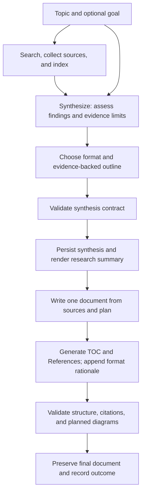

# Evidence-driven Synthesize and Write plan

## Table of contents

- [Purpose and scope](#purpose-and-scope)
- [Current implementation and constraints](#current-implementation-and-constraints)
- [Optional goal parameter](#optional-goal-parameter)
- [Proposed workflow](#proposed-workflow)
- [Evidence and structure contract](#evidence-and-structure-contract)
- [Choosing a useful format](#choosing-a-useful-format)
- [Final output requirements](#final-output-requirements)
- [Diagrams](#diagrams)
- [Validation and failure handling](#validation-and-failure-handling)
- [Persistence and compatibility](#persistence-and-compatibility)
- [Implementation sequence and affected files](#implementation-sequence-and-affected-files)
- [Verification and acceptance criteria](#verification-and-acceptance-criteria)
- [Review decisions and tradeoffs](#review-decisions-and-tradeoffs)

Date: 2026-10-09, America/Costa_Rica. Repository inspected at `f0eea9a`.

Status: implemented on 2026-10-09. The design below records the reviewed implementation plan; see [the implementation runbook](../../SPECS-LOGS/EVIDENCE-DRIVEN-AUTHORING-RUNBOOK.md) for delivered behavior and validation.

## Purpose and scope

Make **Synthesize** decide how to communicate the research and make **Write** follow that evidence-backed decision. The decision must consider the topic, an optional user goal, and the findings actually available in the corpus. The final document must be clear, retain material qualifications and disagreements, and avoid sections that require evidence the research did not produce.

Required final behavior:

- Choose a comparison, tutorial, literature review or research paper structure, explainer, decision brief, hybrid, or another suitable format.
- Produce a topic-specific outline supported by the research; format names must not select another mandatory heading template.
- Put a linked table of contents immediately after the title.
- Cite factual claims inline and include a References section near the end.
- End with a concise explanation of why the chosen format fits the topic, goal, and evidence. Cite factual observations about the evidence in this explanation too.
- Include diagrams when they improve understanding and the evidence supports their contents.

Keep the existing four sub-agents, corpus-only sourcing, immutable source files, citation syntax, and search/fetch budgets. Format selection belongs inside synthesis and does not require a new agent. Every format uses `output/{yyyy-mm-dd-hh-mm-ss}-content.md`. Save the run's start time in UTC to the second with its authoring state and retain that date across resumes. Existing `blog_path` fields carry the dated path for compatibility.

## Current implementation and constraints

| Area | Current behavior | Planned implication |
| --- | --- | --- |
| Analyst | [prompts/analyst_agent.md](../../../prompts/analyst_agent.md) requires six named summary sections, including frameworks and a suggested outline | Replace compulsory summary headings with an evidence contract and an adaptive outline |
| Writer | [prompts/writer_agent.md](../../../prompts/writer_agent.md) and [prompts/orchestrator.md](../../../prompts/orchestrator.md) require the same seven article sections | Update both prompts together; the writer consumes the chosen structure |
| Validation | [services/authoring.py](../../../services/authoring.py) checks exact headings and treats every heading after the title as one of seven required H2 headings | Validate the agreed outline and universal document requirements; allow meaningful H3 subsections |
| Execution | The worker uses [application/run_service.py](../../../application/run_service.py); CLI topic runs use [workflows/research_run.py](../../../workflows/research_run.py), and author-only runs use [workflows/authoring_run.py](../../../workflows/authoring_run.py) | Apply one authoring contract across these paths; do not assume the CLI already routes through `RunService` |
| Phase completion | `RunService` currently handles synthesis, writing, and citation checking as a combined authoring operation | Validate and persist synthesis before invoking the writer; resume must distinguish completed stages |
| Requests | [schemas/requests.py](../../../schemas/requests.py) and [schemas/api.py](../../../schemas/api.py) accept topic and budgets, without a goal | Add an optional per-run goal and preserve it through every handoff |
| Citation gate | Source IDs and reference titles/URLs are checked against corpus files | Preserve these checks; a valid citation alone does not establish that its source supports the claim |
| Groundedness evaluation | [evaluations/judge.py](../../../evaluations/judge.py) receives claim text and a source ID, without the cited source text | Supply actual source excerpts when evaluating support |
| Product rules | [PRD.md](../../../PRD.md) FR-7/FR-8 and [SPECS.md](../../../SPECS.md) PD-015 specify the old structure | Update requirements, agent contracts, fixtures, and evaluations alongside implementation |

The existing 2,000–5,000 word target remains a soft compatibility rule for the first increment. Do not add filler or regenerate a document to satisfy it. Preserve the current `blog_length` reporting behavior and verify that all execution paths propagate it. Format-specific length policies can be a later decision.

## Optional goal parameter

Add `goal: str | None = None` to the research request and HTTP submission contracts, plus `--goal` to the CLI. The goal describes the reader's desired outcome, for example “Help a small team choose a framework” or “Teach a beginner to build a working example.” It is guidance for relevance and presentation, not evidence for factual claims.

Proposed input rules:

- Trim surrounding whitespace; normalize omitted, null, and whitespace-only values to `None`.
- Accept up to 1,000 characters after trimming. Reject non-string, non-null values and overlong goals through the existing input-validation path.
- Topic-only requests continue to work. When no goal is supplied, infer a modest reader objective from the topic and findings and record that it was inferred.
- A goal may express a preferred format, audience, or task. Honor it where evidence permits. If it asks for a tutorial without procedural evidence or a paper without research results, adapt the structure and explain the limitation.
- Preserve the original goal rather than silently rewriting it into the inferred reader objective.

Propagation must cover:

1. `SubmissionRequest.to_research_request()` and `application/job_service.py` payload normalization.
2. `workflows/cli.py` argument parsing and request creation.
3. Worker reconstruction from stored job payloads and `RunService._request()` reconstruction.
4. `request.json`, search-only runs, subsequent corpus/author-only runs, and resume.
5. Explicit topic/goal context in analyst and writer handoffs; an author-only invocation cannot rely on earlier chat messages still being present.

Use persisted `request.json` as the authoritative authoring input. Avoid duplicating goal across state models unless execution requires it; if a state snapshot carries goal, validate that it agrees with the persisted request. Fix request reconstruction so it cannot drop goal or overwrite the saved request with a topic-only version.

Idempotency must account for goal. Include a nonempty normalized goal in the canonical payload/hash; omit the key when goal is `None` so existing topic-only payload hashes remain compatible. Same key plus a changed nonempty goal must produce the existing idempotency conflict. Equivalent whitespace-normalized goals must compare equal.

For an existing workspace, use its saved goal. Reject a conflicting CLI override and require a new run for changed inputs. Do not alter goal during resume. Goals may inform the existing query-variant planner about useful evidence types, within the existing search budget; the final output format is chosen only after examining the collected evidence.

## Proposed workflow

**Synthesize:** Read every numbered corpus source and the index. Identify relevant findings, disagreements, limitations, and missing evidence. Decide the reader objective from the topic and optional goal. Choose the format, outline, and any useful diagrams only after this assessment.

**Persist:** Have the analyst produce a typed `research/synthesis.json` artifact. A deterministic service validates it and renders the existing `research/summary.md` from the same validated data. This creates one authoritative synthesis decision and avoids two independently authored artifacts drifting apart. The summary should follow the selected outline and explain findings and gaps, without requiring the old six headings.

**Write:** Read the source corpus, validated synthesis, and rendered summary. Follow the selected outline, preserve qualifications, and cite the actual source files rather than the summary. Write the substantive document once. The writer must not silently change the agreed format or introduce unsupported sections to make the document resemble a standard article.

**Finalize:** A deterministic service derives the TOC from actual headings and renders reference entries from corpus metadata and cited IDs. The writer supplies the closing format rationale from the recorded decision. Finalization is part of the single generation pipeline and does not entail another model draft.

**Check:** Validate the finalized document, run the existing bounded citation-repair process when needed, and record the results. Keep deterministic finalization idempotent so it can run again after a permitted repair or interruption.

## Evidence and structure contract

Introduce Pydantic contracts in a proposed `schemas/authoring.py`, following [docs/ENGINEERING.md](../../ENGINEERING.md). Keep a stable internal schema while allowing the reader-facing structure to vary.

| Field group | Proposed contents and purpose |
| --- | --- |
| Identity | Contract version, run ID, normalized topic/goal, and fingerprint of the request and source corpus |
| Reader objective | The intended reader outcome; whether it came from an explicit goal or was inferred |
| Corpus assessment | Source IDs considered, evidence types, relevance, breadth, timeliness where known, and material limitations |
| Findings | Stable finding IDs, statements, supporting source IDs and locators/excerpts, qualifications, and conflicting evidence |
| Uncertainty and gaps | What remains unknown, conflicting, outdated, incomparable, or insufficiently supported; explicit unknowns instead of invented details |
| Format decision | A descriptive format label, why it fits, brief reasons viable alternatives fit less well, and confidence expressed as a qualitative assessment |
| Outline | Ordered sections with stable IDs, titles, heading levels, reader purpose, finding IDs, and any evidence limitation the section must preserve |
| Diagrams | Optional placement, diagram type, reader purpose, supported relationships, finding/source IDs, and caption requirements |
| Closing rationale | A concise reader-facing explanation to include at the end, with supporting IDs for factual statements about the corpus |

The format label must allow custom and hybrid structures. Format examples are guidance rather than an exhaustive enum that restricts presentation.

For each substantive planned section, identify which findings it communicates. A section may explain a gap or uncertainty rather than assert a supported finding. Navigation, reference lists, and the editorial explanation do not require invented findings to satisfy a schema.

Evidence links should distinguish **supports**, **qualifies**, and **contradicts**. Capture context such as version, timeframe, environment, or measurement conditions where it changes the meaning. An opinion from one vendor is not a general consensus, and two sources repeating the same underlying claim are not necessarily independent corroboration.

Use short source excerpts or precise locators and source hashes for auditability. Checking that an excerpt occurs in a source verifies provenance; semantic support still requires assessment. Record all considered sources, but select citations for relevance rather than adding them simply to increase source coverage.

## Choosing a useful format

Selection criteria, in order:

1. What does the explicit goal ask the reader to understand, decide, or do? If omitted, what objective does the topic reasonably suggest?
2. What does the corpus actually support: comparable alternatives, reproducible steps, methods/results, a chronology, mechanisms, or unresolved disagreement?
3. Which organization makes that evidence easiest to understand while exposing important limitations?
4. Which proposed sections would require unsupported claims or unnecessary repetition? Remove or revise them before writing.

| Evidence and reader need | Possible format | Conditions and nuance to preserve |
| --- | --- | --- |
| Choosing between alternatives; evidence covers comparable criteria | Comparison or decision brief | Separate common criteria from unknown or incomparable values; avoid unsupported winners and scores |
| Completing a practical task; sources provide prerequisites and steps | Tutorial or implementation guide | Cite procedural details, version assumptions, and constraints; do not claim commands were tested unless they were |
| Understanding a research question; papers, methods, and results are available | Literature review or research paper structure | Explain the review method and limitations; distinguish published results from this run's synthesis; do not invent experiments or original findings |
| Understanding a mechanism or unfamiliar topic | Explainer | Build concepts in a useful order and distinguish established descriptions from interpretation |
| Understanding changes over time | Chronology or historical analysis | Use supported dates and separate temporal sequence from claims of causation |
| Conflicting or sparse sources | Evidence review or qualified brief | Make uncertainty central, avoid an artificial consensus, and state what cannot yet be concluded |
| A goal requires both choosing and doing, with evidence for both | Hybrid structure | Combine only the sections that serve the goal; do not concatenate several full templates |

For the same topic, “Choose a framework for our small team” might produce a comparison, while “Learn the execution model” might produce an explainer. A “build a working example” goal might yield a tutorial only when the corpus supports the necessary steps. These are illustrative outcomes, not fixed mappings or test expectations that require one label.

Record a short explanation of the decision and relevant alternatives. The final rationale is a useful editorial explanation, not a transcript of the model's internal deliberation.

## Final output requirements

The universal document envelope is:

1. One H1 title.
2. `## Table of contents`, immediately after the title and before any abstract or introduction.
3. Adaptive body sections and subsections from the validated outline.
4. `## References`, listing each cited corpus source once with its ID, title, and URL.
5. `## Why this format`, as the final section, explaining the fit to the topic, goal, and evidence, with citations where it makes factual observations.

Placing References immediately before the rationale satisfies the request for citations at the end while keeping the format explanation as the document's last section. The reference list must include citations used anywhere in the document, including that last section and diagram captions. No appendix or other section follows the rationale.

TOC behavior:

- Generate links from final H2 and H3 headings in document order, including References and Why this format.
- Exclude the H1 title and the TOC's own heading.
- Use one shared heading parser and anchor algorithm for generation and validation. Handle punctuation, repeated titles, non-ASCII text, and headings containing inline formatting.
- Ignore apparent headings inside fenced code and diagram blocks. Verify anchors in the Markdown renderer used to review the output.
- Rebuild after permitted edits; do not ask the model to maintain TOC links manually.

Writing behavior:

- Every non-obvious factual claim needs an inline `[S-NN]` that resolves to a corpus source and supports the claim.
- Preserve material dissent, evidence strength, scope, and limits close to the claims they qualify.
- Label inference, recommendation, and hypothetical examples so they are not presented as sourced facts or observed results.
- Use tables when they clarify a comparison, and mark missing values as unknown rather than inferring them.
- Do not manufacture frameworks, forecasts, conclusions, or recommendations to populate a conventional heading.

The closing explanation should usually take one short paragraph. For example, it can explain that a comparison serves a selection goal and that the sources support some shared criteria while leaving performance estimates incomparable. Cite the observations about source contents; the editorial preference itself does not need a fabricated factual citation.

## Diagrams

Use diagrams when a relationship, sequence, architecture, or decision process would be harder to understand in prose. The analyst proposes their purpose and placement; the writer creates them from supported findings.

- Prefer fenced Mermaid diagrams embedded in Markdown for architecture, sequences, and flows. This stays compatible with the existing restriction on generated images.
- Keep diagrams optional. A short comparison or sparse evidence may need none.
- Trace factual nodes and relationships to findings and source IDs. Include a readable caption or accompanying prose with citations and the relevant caveats.
- Distinguish a conceptual illustration from a documented architecture. Do not turn inferred relationships into reported facts.
- Validate syntax and rendering using an offline-capable check in the implementation test environment. Keep a prose description so the findings remain understandable in viewers without Mermaid support.

The workflow diagram in this plan describes the proposed design; it does not imply that every generated research document needs a diagram.

## Validation and failure handling

Replace exact-heading comparison with Markdown-aware validation in small services, keeping the orchestrators thin. Existing citation checks continue to operate on the whole finalized document.

| Check | What it can establish | Outcome |
| --- | --- | --- |
| Synthesis schema | Required fields, valid source/finding references, ordered outline, explicit decision, input fingerprint match | Invalid synthesis blocks Write and records a synthesis failure |
| Evidence provenance | Referenced IDs exist; stored excerpts/locators correspond to immutable source content | Invalid links block use of the synthesis |
| Document structure | One title, top TOC, agreed heading hierarchy/order, References before the final rationale, no sections after the rationale | Fail with the existing `blog_structure` reason and detailed structural findings |
| TOC integrity | Entries match actual headings and anchors, without entries from code fences | Deterministic finalization repairs navigation; validation fails if inconsistencies remain |
| Citations and References | IDs resolve; title/URL entries match; all cited IDs appear once in References | Use the existing maximum of two citation repair passes; preserve the last draft if checks still fail |
| Diagram structure | Planned placement, caption/source links, and valid renderable syntax | Fix deterministic rendering issues; otherwise record an authoring failure without silently dropping necessary evidence |
| Length | Existing 2,000–5,000 word compatibility target | Preserve draft and propagate `blog_length`; no regeneration or filler |
| Semantic quality | Claims supported by supplied evidence; format useful for goal; nuance retained | Source-aware evaluation and review; do not mislabel structural checks as proof of groundedness |

Reject a missing synthesis artifact, invalid custom outline, or unexplained format change instead of silently reverting to the seven-heading template. Preserve generated artifacts for diagnosis.

Use the existing bounded phase retry policy for synthesis failures where applicable, and persist attempts. Do not permit a structure failure or resume to trigger another full writer generation. Citation repairs stay limited to named issues; deterministic reference/TOC updates may follow. Expanding repair scope to rewrite substantive sections is a separate product decision.

Keep stable public reason codes where possible and put detailed violations in `output/authoring.json`. Any new terminal synthesis or diagram reason must be registered in outcome classification so a failed authoring gate cannot be reported as succeeded. Verify failure propagation through both the worker and milestone workflows.

## Persistence and compatibility

Proposed run artifacts:

| Artifact | Owner and purpose |
| --- | --- |
| `request.json` | Validated topic, optional goal, and search budget; authoritative input |
| `research/synthesis.json` | Analyst's versioned evidence assessment, chosen format, outline, and diagram plan; validated before use |
| `research/summary.md` | Deterministic, readable rendering of the validated synthesis |
| `output/{yyyy-mm-dd-hh-mm-ss}-content.md` | Final reader-facing document with TOC, citations, References, and closing rationale |
| `output/authoring_state.json` | Coordinator-owned contract version, stage progress, input/artifact fingerprints, generation state, and repair attempts |
| `output/authoring.json` | Gate findings, selected format, synthesis path, and completion/failure details |
| `output/run.json` | Existing final run report and status reasons |

Use atomic writes for validated artifacts and state. Mark Synthesize complete only after the JSON validates and the summary is rendered. Mark Write complete only after generation, finalization, and structural validation. Persist citation completion separately after the gate passes.

Record the writer generation attempt before invoking the model and persist the repair count before each repair. On interruption, reconcile saved artifacts and graph checkpoints. An ambiguous generation must not automatically restart and consume another draft. Reuse a validated synthesis on resume when topic, goal, source hashes, and contract version match.

For new runs, explicitly persist authoring contract version 2 before synthesis. Existing runs without a version marker are legacy version 1. Keep completed legacy artifacts readable and use compatible versioned prompts/checks when completing legacy runs. A missing or malformed version-2 synthesis must not be mistaken for a legacy run. Do not migrate or rewrite existing outputs automatically.

The artifact reader already allows JSON and Markdown under `research/` and `output/`; verify the new artifacts work through the current download API. Keep the `RunReport` shape and `blog_path` field for the first increment; record detailed format metadata in the authoring artifacts to avoid unnecessary endpoint changes.

## Implementation sequence and affected files

The paths below identify existing files to update and proposed new files; creating this plan does not create the proposed modules.

| Step | Work | Main files | Completion evidence |
| --- | --- | --- | --- |
| 1. Align the product contract | Define optional goal, adaptive body, TOC, final rationale, References placement, and compatibility behavior | `PRD.md`, `SPECS.md`, `docs/architecture/agents/{analyst_agent,writer_agent,orchestrator}/{skill,contract}.md`, repository reference `skills/content-writer/SKILL.md` | Requirements no longer mandate old headings for new runs |
| 2. Carry goal end to end | Add shared validation, CLI flag, API field/conversion, payload hashing, persistence, and reconstruction | `schemas/common.py`, `schemas/requests.py`, `schemas/api.py`, `application/job_service.py`, `workflows/cli.py`, `workers/research_worker.py`, `application/run_service.py`, `services/workspace.py`; audit search/fetch request reconstruction | Topic-only compatibility and goal-preserving API/CLI/resume tests pass |
| 3. Define synthesis and state contracts | Add typed findings, decision, adaptive outline, optional diagrams, and versioned authoring state | Proposed `schemas/authoring.py`, synthesis validation/rendering service, and persistence helpers | Valid/invalid evidence maps and arbitrary useful outlines are covered offline |
| 4. Update Synthesize and Write | Pass topic/goal explicitly, select format from evidence, write from validated plan, and retain versioned legacy behavior | `prompts/analyst_agent.md`, `prompts/writer_agent.md`, `prompts/orchestrator.md`, `prompts/catalog.py`, `agents/deep_research.py` | Scripted models demonstrate handoff and version routing without network access |
| 5. Finalize and validate Markdown | Add shared heading/anchor parsing, deterministic TOC/References rendering, adaptive checks, and diagram checks | `services/authoring.py`, proposed Markdown finalization service, `tools/authoring_tools.py` | Multiple structures, nested headings, closing citations, and broken documents are checked correctly |
| 6. Wire all execution paths | Validate between phases, persist attempts/stages, retain repair limits, and propagate outcomes | `application/run_service.py`, `workflows/authoring_run.py`, `workflows/research_run.py`, `workflows/resume.py`, `services/reporting.py`, reporting workflow | Worker, CLI, author-only, and resumed runs use the same authoring rules |
| 7. Improve evaluation | Give judges actual source excerpts; assess goal fit, nuance, and evidence support; update mixed-format fixtures and scoring | `evaluations/scoring.py`, `evaluations/judge.py`, `evaluations/dataset.py`, `evaluations/golden_dataset.json`, `evaluations/run_eval.py`, `evaluations/workflow_fixtures.py`, `application/fixtures.py`, authoring demos | Evaluations distinguish citation validity from semantic support and accept useful custom formats |
| 8. Document and verify | Update usage examples, walkthroughs, and agent documentation; capture later implementation evidence | `README.md`, `docs/architecture/README.md`, relevant `docs/pages/` documentation, proposed implementation runbook | Reviewable examples show two goals producing different useful organizations |

Implement steps 3–6 as one compatible authoring change: updating prompts without validators would reject the new output; relaxing validators without the evidence contract would lose guarantees. Follow the repository's typed boundaries and exception hierarchy and avoid adding model/provider calls outside `LLMService`.

## Verification and acceptance criteria

Use offline fixture corpora and scripted models for deterministic tests. Fixtures must include genuine supporting and conflicting passages rather than merely repeating the claim text in fake output. A scripted model can verify plumbing but cannot prove a real model chooses a useful format.

Required scenarios:

- Topic-only request infers a reader objective and creates a useful structure.
- Same topic with a decision goal and a learning goal yields appropriately different organizations; review usefulness rather than exact wording or one mandatory format label.
- Goal survives HTTP admission, canonical hashing, worker reconstruction, search-only persistence, author-only execution, and resume.
- Omitted/null/blank goals behave equivalently; invalid types and long goals fail validation; changed nonempty goals conflict under the same idempotency key.
- Comparison with asymmetric evidence leaves missing criteria explicit and does not invent rankings.
- Tutorial with procedural evidence includes prerequisites and supported steps; insufficient evidence produces a qualified guide or another suitable format.
- Research paper structure distinguishes literature findings and search/review methods from original experiments.
- Conflicting sources remain visible with citations on both sides; sparse sources produce qualified conclusions.
- A custom or hybrid outline and nested headings pass without resembling the old seven-section document.
- TOC is first after the title, matches final H2/H3 headings, handles duplicate/non-ASCII titles, and ignores fenced code/diagrams.
- References include IDs from body text, tables, captions, and the final rationale; entries resolve with correct title/URL; the rationale is the final section.
- A useful diagram renders, has cited support and a prose description; a document needing no diagram passes without one.
- Missing/invalid synthesis, unknown findings/sources, changed inputs, broken heading order, empty rationale, and unsupported format changes are reported correctly.
- A known source ID attached to a contradictory or unrelated claim fails source-aware groundedness evaluation despite passing source-ID validation.
- Citation repairs and interruption/resume never reset the two-pass budget or generate a second full draft; source hashes remain unchanged.
- Legacy runs and old topic-only request payloads remain readable and compatible; new invalid runs cannot fall back to legacy validation.
- Out-of-range length preserves the document and appears in the final outcome consistently across execution paths.

Extend the relevant existing authoring, CLI, workspace, API, worker, reporting, artifact-reader, and evaluation tests; add focused contract/finalizer tests for the new behavior.

Evaluation changes must parse document regions so TOC entries and References do not count as factual claims or inflate coverage. Assess prose, table claims, diagram descriptions, and factual claims in the closing rationale. Support multi-source claims and supply bounded relevant excerpts with qualifications to the judge. Treat offline always-supported judges as plumbing fixtures, not evidence of groundedness.

For later implementation verification, run the focused offline tests first, followed by `make check`, `make boundary`, `make build`, and `make eval-offline`. Use an isolated output location for evaluation artifacts. Source-aware live comparisons are useful after implementation, with the same fixed corpus for baseline and adaptive outputs; do not perform live calls as part of this planning task.

Definition of done for the feature:

- [x] Goal is optional, validated, persisted, and honored without losing topic-only compatibility.
- [x] Synthesize produces a validated evidence-backed decision before Write starts.
- [x] Writer uses an adaptive outline and preserves material nuance and limitations.
- [x] Final output has a working TOC at the top, inline citations, References near the end, and a cited format explanation as its final section.
- [x] Diagrams appear only when useful and supported.
- [x] Structural checks, source-aware evaluation, and outcome reporting agree on their distinct responsibilities.
- [x] Single-generation and citation-repair budgets survive interruption and resume.
- [x] All execution paths, fixtures, product requirements, and agent contracts use the same versioned rules.

## Review decisions and tradeoffs

The recommended first implementation keeps the output path, four-agent architecture, citation syntax, and soft length policy. It adds a structured synthesis artifact because a free-form “suggested outline” alone cannot reliably connect format choice, evidence, validation, and resume. Rendering the readable summary from that artifact avoids maintaining two independent decisions.

The plan adopts References followed by Why this format, with the rationale last. It uses optional goal as a reader objective rather than a required format switch. Format examples guide judgment but never impose a closed set of templates. Semantic support is evaluated using source text; deterministic validation retains responsibility for inspectable structural and provenance rules.

Review can adjust the proposed goal limit, the exact authoring contract fields, and the later length policy. Those choices do not change the central requirement: select the structure from the reader's goal and available evidence, make that choice reviewable, and carry it faithfully into a cited final document.
