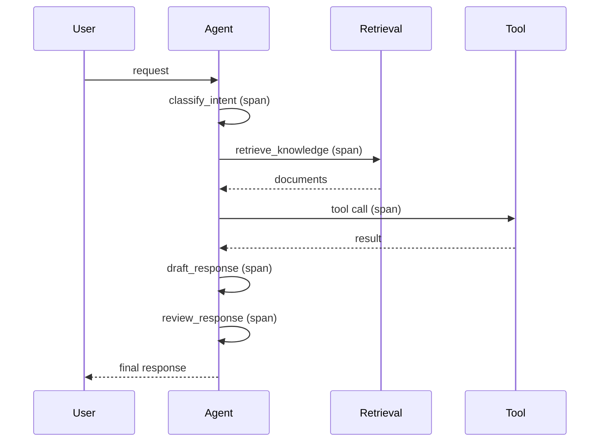
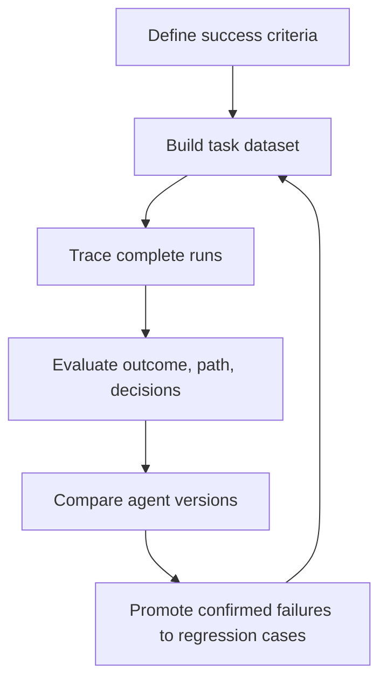

# Evaluating Tool-Using AI Agents: An Evidence-Graded Implementation Guide

## Table of contents

- [Why tool-using agents break output-only evaluation](#why-tool-using-agents-break-output-only-evaluation)
- [Define success criteria and a metric contract before you build](#define-success-criteria-and-a-metric-contract-before-you-build)
- [Build a task dataset that reflects production](#build-a-task-dataset-that-reflects-production)
  - [Cold start: generating synthetic tasks and ground truth](#cold-start-generating-synthetic-tasks-and-ground-truth)
- [Choose evaluators: deterministic checks, LLM judges, and human review](#choose-evaluators-deterministic-checks-llm-judges-and-human-review)
  - [Score outcomes against system state, not the agent's message](#score-outcomes-against-system-state-not-the-agents-message)
  - [Evaluate routing and tool arguments separately](#evaluate-routing-and-tool-arguments-separately)
  - [Calibrate LLM judges and place human review at the boundary](#calibrate-llm-judges-and-place-human-review-at-the-boundary)
- [Instrument observability: complete traces and OpenTelemetry conventions](#instrument-observability-complete-traces-and-opentelemetry-conventions)
- [Analyze failures with taxonomies and diagnostic probes](#analyze-failures-with-taxonomies-and-diagnostic-probes)
- [Bound retries, loops, and evaluation cost](#bound-retries-loops-and-evaluation-cost)
- [Close the loop: from production failures to regression tests](#close-the-loop-from-production-failures-to-regression-tests)
- [Evaluate multi-agent and end-to-end behavior](#evaluate-multi-agent-and-end-to-end-behavior)
- [Use benchmarks as one signal, not a guarantee](#use-benchmarks-as-one-signal-not-a-guarantee)
- [Governance and trust metrics for production agents](#governance-and-trust-metrics-for-production-agents)
- [Documented techniques vs. untested examples: reading this guide critically](#documented-techniques-vs-untested-examples-reading-this-guide-critically)
- [References](#references)
- [Why this format](#why-this-format)

## Why tool-using agents break output-only evaluation

An AI agent can produce a correct, fluent answer while the run that produced it was broken. LangChain's evaluation framework puts it bluntly: "Correct final answers can hide broken reasoning" — an agent that hallucinates a tool call may still land on the right result, and a retrieval that returns irrelevant documents may not matter if the synthesis gets lucky [S-05]. Arize makes the same point from the production side: "A convincing response can follow an inefficient, unsafe, or partially failed run" [S-30]. Comet describes the mechanism as a silent failure: "An agent can produce correct output through an inefficient or incorrect process" [S-06]. All three are vendor engineering blogs, so this is documented practitioner consensus rather than an independently measured result.

The second reason output-only scoring fails is non-determinism. Google Cloud's Agent Factory recap contrasts agent evaluation with traditional unit tests: "Because agents are non-deterministic, you can give the same prompt twice and get two different--but equally valid--outcomes" [S-04]. Comet notes that "the same input triggers different tool selections, reasoning paths and outputs across multiple runs" [S-06], and Delos argues that "statistical output demands statistical evaluation" [S-16]. Arize describes the reliability measures teams use to make this concrete: pass@1 (success on a single attempt), pass@k (at least one of *k* attempts succeeds) and pass^k (all *k* attempts succeed, "a stricter measure of consistency") [S-30]. The pass@k / pass^k framing is attributed by Arize to Anthropic's guide; the corpus does not include that primary source, so treat the attribution as secondhand.

The practical consequence is that evaluation must cover the run, not just the response. Arize breaks that into four scopes — outcome, path, individual decisions, and reliability across repeated runs — and argues that together they turn a pass/fail result into an actionable diagnosis [S-30]. The rest of this guide follows that sequence, from defining success through instrumenting traces to closing the loop back into the test set.

## Define success criteria and a metric contract before you build

Before choosing evaluators, decide what the evidence is for. Pedro Pizarro argues the sequence should run backwards from the dashboard: "First decide which production decision the evidence must support: release, expand, constrain, redesign or stop" [S-17]. Arize's six-step loop opens the same way — "Define success before choosing evaluators" [S-30] — and its specification table breaks success into task outcome, agent actions, constraints, failure handling, and quality criteria, each pointing to evidence that can be captured during a run [S-30].

Pizarro's "metric contract" is a compact way to record this. For each metric, record its definition, denominator, data source, collection period and decision owner, and "state which decision the metric can authorise and which conclusion it cannot support" [S-17]. The format is one practitioner's proposal; no source in the corpus tests whether it improves outcomes.

Two cautions belong next to the contract. First, technical-operation metrics are not task-success metrics: "A system can be fast, cheap and wrong" [S-17]. Second, thresholds are hypotheses, not evidence: "The right threshold depends on the workflow, impact and review model. A suggested number in a workshop is a hypothesis, not evidence" [S-17].

Metrics should also be layered so that a single number cannot hide a regression. Pizarro proposes three levels — does it run (latency, cost per attempted task, availability, error rates), does it do the work (task completion against a defined acceptance condition, rework, tool-use accuracy, escalation rate), and is it worth operating (cost per successful task, cycle-time change, unsupported-claim rate, unauthorised-action rate) [S-17]. Comet's layering is similar but not identical: foundation model, individual components, and final outputs [S-06]. Arize warns why the layering matters: "An overall pass rate can improve while one tool, workflow, or high-risk task becomes less reliable" [S-30]. Neither layering scheme is validated against outcomes in the corpus.

## Build a task dataset that reflects production

An agent evaluation dataset is not a set of input-output pairs. LangChain states the requirement directly: "For AI agents, ground truth must include expected tool calls and reasoning steps" [S-05]. If the agent should verify customer identity before processing a refund, that verification step is part of the ground truth; if it should retrieve specific document types, those retrieval expectations belong in the annotations [S-05].

LangChain organizes test cases into three categories — happy path, edge cases, and adversarial inputs designed to probe failure modes like prompt injection or off-topic requests [S-05]. Arize's step 2 says to "Start with common production requests, high-risk edge cases, and failures collected from traces, evaluator results, or human review" [S-30], and to preserve for each row the input, relevant context, available tools, expected output or system state, and metadata such as task type or failure category [S-30]. The three-category split and the production-seeded approach are practitioner conventions; no source measures how much coverage they achieve.

Seeding from real traffic is the recommended default. LangChain advises starting from production traces and converting a failure into a test case with the corrected trajectory as ground truth, "so your test coverage reflects actual user interactions rather than synthetic scenarios" [S-05]. Arize's curation workflow filters traces for failed evaluations, selects representative examples rather than exporting every failure, adds the expected outcome or human-reviewed label, and saves them as a regression dataset [S-30].

Cost is a first-order constraint on how much of that traffic you can afford to score. Comet states plainly that "Comprehensive agent evaluation is expensive" — a single session can involve hundreds of LLM calls, and evaluating each one multiplies cost [S-06]. LangChain's production-monitoring checklist calls for "sampling strategies that balance coverage with evaluation cost" [S-05], and warns that "Trajectory evaluation adds real overhead" — building reference trajectories, maintaining evaluator infrastructure, and paying for LLM-as-a-judge calls — so it is not always worth it [S-05]. No source quantifies the cost of specific evaluation configurations beyond noting that some exceed the baseline agent workload.

### Cold start: generating synthetic tasks and ground truth

When a team has no dataset at all, Google Cloud documents a four-step cold-start recipe: (1) ask an LLM to generate realistic user tasks; (2) have an "expert" agent produce the ideal, step-by-step solution for each task; (3) have a weaker or different agent attempt the same tasks to produce flawed attempts; and (4) use an LLM-as-a-judge to compare the imperfect attempts against the perfect solutions and score them [S-04]. This is a documented procedure, but it is presented in a single vendor demo (Google Cloud ADK/Vertex AI) and is not independently validated in the corpus. Treat it as a way to bootstrap a first dataset, not as a method with measured coverage.

## Choose evaluators: deterministic checks, LLM judges, and human review

The evaluator-selection rule that ties the rest of this section together comes from Arize: "Use the most direct evidence and the least subjective method capable of deciding the case. When the available evidence cannot support a reliable automated verdict, defer rather than force a pass or fail" [S-30]. In practice that means deterministic code checks for observable conditions, an LLM judge for narrowly defined semantic criteria, and human review when evidence is incomplete, evaluators disagree, or an incorrect verdict could permit a high-consequence action [S-30].

Arize also names three recurring human-review patterns: calibration review (domain experts label a representative set of runs before deployment so automated verdicts can be compared against them), disagreement adjudication (a reviewer resolves cases where evaluators disagree, abstain, or produce incompatible rationales), and ongoing audit (periodic sampling of automated passes and failures to detect evaluator drift and confident errors) [S-30]. The three subsections below apply the rule to the failure surfaces that most often get conflated.

### Score outcomes against system state, not the agent's message

Outcome evaluation asks whether the agent left the task in an acceptable final state — a database row, a ticketing system, a codebase, a generated document [S-30]. The agent's own message is not evidence of that state. In Arize's refund example, success requires the correct order to be refunded for the approved amount, the customer record to be updated, and the case to leave the unresolved queue; "The agent's confirmation message cannot establish those conditions" [S-30]. The evaluator must inspect the affected systems after execution and compare their actual state against explicit completion criteria [S-30].

This is why environment-checking benchmarks matter. Arize points to Terminal-Bench, where "comprehensive tests verify the environment they leave behind rather than the explanation they provide", capturing what final-answer grading misses because "task completion often lives in the resulting state" [S-30]. Structured outcomes can usually be checked with deterministic assertions, and those checks can also represent partial completion: "A recorded refund with an open case receives a different verdict from a run that produced no valid state change" [S-30]. This guidance is illustrated with a worked refund scenario rather than measured across deployments.

### Evaluate routing and tool arguments separately

Routing failures masquerade as quality failures unless they are scored separately. Arize's rule: "Evaluate the router separately from the downstream skill so a routing failure does not get mistaken for a response-quality failure" [S-30]. The router has two axes. Tool or skill selection tests whether the router chose the best available tool, selected no tool when none was needed, or requested clarification when the input was insufficient. Parameter extraction tests whether it produced schema-valid arguments supported by the request and included every required field [S-30].

The dataset should be built to expose routing errors: overlapping tool descriptions, missing required parameters, requests that require no tool, multi-turn context, and misleading identifiers. Arize's example is a request for order status that supplies a shipping tracking number — the router should enter the order-status workflow but must not silently populate an `order_id` field with the tracking number [S-30]. When router accuracy is low, inspect failures by route: repeated confusion between the same two tools usually points to overlapping tool descriptions or an underspecified router prompt, while correct tool selection with poor arguments points to the tool schema or extraction logic [S-30].

The Eval AI Library treats tool correctness as a distinct agent metric — "Whether correct tools were called" — alongside tool error detection, framing agent metrics as "behavioral properties" rather than answer-quality measures [S-18]. That library is product documentation for a metrics vendor, so its metric list reflects that vendor's design choices.

### Calibrate LLM judges and place human review at the boundary

LLM-as-a-judge is the practical default for trajectory scoring because human labeling cannot scale across the volume of traces agents generate [S-05]. But judges are unreliable in specific, documented ways. LangChain lists the failure modes: "LLM judges exhibit bias and inconsistency, like scoring responses differently based on presentation order, favoring verbose answers over concise ones, and drifting in their scoring behavior over time" [S-05]. The benchmark survey in S-09 catalogues the same biases — position bias, verbosity/length bias, and self-enhancement bias — and adds that LLM evaluations are stochastic, can be inconsistent even with the same input, and are "highly dependent on the prompt design and the quality of the Judge model itself" [S-09]. That bias taxonomy is a literature synthesis; the corpus does not include the underlying bias studies.

The mitigations are consistent across sources. LangChain recommends structured rubrics that constrain judge outputs to specific criteria, multiple judge passes with aggregated scores to reduce variance, calibration against human-labeled examples, decomposing complex assessments into simpler checks, and monitoring judge consistency over time to catch drift [S-05]. Google Cloud frames the same idea as a "calibration loop": start with human experts to create a small, high-quality "golden dataset", then fine-tune an LLM-as-a-judge until its scores align with your human reviewers [S-04]. Arize adds that each evaluator should isolate one property, define the evidence it may use, and specify what qualifies as a pass, and that the judge should cite the evidence behind its verdict [S-30].

Human review belongs at the boundary of uncertainty and consequence [S-30]. AgentixLabs' production checklist gives a concrete starting heuristic: "Set a human review queue for 1-5% of runs" [S-22]. That figure is one team's starting heuristic, not a validated threshold. Arize adds that review should be mandatory when an incorrect verdict could permit a high-consequence action, and that each reviewed case should preserve the criterion, evidence, final verdict, and rationale so it can become a calibration example or regression test [S-30].

## Instrument observability: complete traces and OpenTelemetry conventions

Observability is the substrate that makes trajectory evaluation possible. AgentixLabs' minimum baseline is blunt: "If you only do one thing, capture a complete per-run trace" [S-22]. The trace should contain run metadata (run_id, environment, redacted user/org identifiers, channel, locale, policy flags), prompting inputs (system prompt version, tool registry version, templates), retrieval details (queries, top-k, document IDs, snippets), tool calls (name, arguments, sanitized responses, latency, error codes), model outputs (final response, structured outputs, refusal or safety events), and cost and performance (tokens in/out, estimated cost, total and step-level latency) [S-22].

Structure matters as much as content. Comet notes that "Agent traces form trees or graphs rather than sequences" — an agent may explore multiple tool options, backtrack, or delegate to sub-agents — so "Visualizing these traces as hierarchical trees rather than flat logs becomes essential for debugging" [S-06]. LangChain explains the failure mode when structure is lost: "Traditional tracing tools display spans in a flat, linear sequence", and when they linearize nested tool calls and reasoning operations, "the conversational context gets lost" [S-05]. AgentixLabs adds the framing that uptime is not quality: "You can have 99.9% availability and still deliver harmful or wrong answers" [S-22]. Trace-element checklists differ slightly across S-06, S-22 and S-23; no source reconciles them into one schema.

The emerging standard for the trace format is OpenTelemetry's GenAI semantic conventions. Comet calls them "emerging standards for structured trace logging" that enable consistent monitoring across frameworks [S-06], and Praesidia states that "OpenTelemetry is the standard to adopt for this" [S-29]. The versioning caveat is important: BuildMVPFast reports that "the GenAI and MCP conventions are still Development, with no public stabilization date", that the project deprecated every `gen_ai.*` attribute in release v1.42.0 (June 12, 2026) and moved them to a dedicated repository, and that "your dashboards, collectors, and field mappings should be treated as versioned infrastructure, not as a schema that is done forever" [S-23]. The same source frames the mental model: "a multi-step AI agent is a distributed system", where each step is a service boundary with its own failure modes and latency profile [S-23]. S-23 is a practitioner blog reporting on the OpenTelemetry project; the corpus does not include the specification itself.

<!-- diagram: traced-run -->

A single agent run as a trace tree: each LLM call, retrieval step and tool call becomes a span with parent-child relationships, token counts and duration. BuildMVPFast shows this span model for a customer-support agent and notes that "a multi-step AI agent is a distributed system" [S-23], while Praesidia explains that "Logs, metrics, and traces address different questions." [S-29]

## Analyze failures with taxonomies and diagnostic probes

Consistent failure analysis starts with a predefined taxonomy. AgentixLabs' checklist gives a concrete one: "Create a failure taxonomy: hallucination, tool error, policy refusal, partial answer, loop" [S-22]. NHI Mgmt Group, summarizing HoneyHive guidance, makes the same recommendation — "Define semantic failure classes up front" with labels for hallucination, tool misuse, policy deviation, and unsafe response patterns, "so evaluation rules can run consistently across production traffic" [S-25].

Benchmark error analysis shows where those failures cluster. WildToolBench, a 1,024-task benchmark built from real user logs, reports that "Wrong Name / Missing Info" and "Redundant Call" (23.06% in Gemini-2.0-Thinking) "emerge as the most prevalent errors", while parameter-level errors such as "Param Type Error" or "Param Hallucination" are consistently lower across all models [S-08]. The paper's conclusion is that "the primary challenge in LLM tool-use has shifted from syntactic correctness to semantic and logical reasoning" [S-08]. That error distribution is specific to WildToolBench's dataset and may not transfer to other domains.

Diagnostic probe tools — canaries — can isolate tool-selection weaknesses that capability rankings miss. AI Accelerator Institute reports a preprint by Anand and Chattaraj that plants six categories of canary tools inside an agent's MCP toolset: semantic decoys, parameter traps, capability mirages, prerequisite blindness, temporal decoys, and granularity traps [S-15]. The reported headline is that "The capability tier fails to predict safety on its own", with canary susceptibility varying "by a factor of roughly 36 across the eight models tested" [S-15]. This is secondhand reporting of a preprint (arXiv 2608.04719) by a practitioner news site; the paper itself is not in the corpus and the result is not peer-reviewed here.

## Bound retries, loops, and evaluation cost

Retry and loop behavior should be explicit evaluation targets rather than an implementation detail. Arize's recovery-and-escalation evaluator pattern pairs "Code checks for retry limits and required escalations" with an LLM judge for recovery quality [S-30]. BuildMVPFast recommends tracing `agent.iteration_count` specifically to "Detect infinite loops in ReAct agents" [S-23]. AgentixLabs ties cost to outcomes: "Track cost per successful outcome, not cost per request" [S-22]. Arize's release scorecard places cost per successful task, P95 latency, and tokens per successful task under operational constraints, and retry rate under failure diagnostics [S-30]. No source specifies concrete retry limits or backoff parameters; the guidance is to make limits explicit and measurable, not what the limits should be.

Evaluation cost is the other half of the budget question. Comet notes that comprehensive evaluation is expensive and that some configurations require "substantially more resources than the baseline agent workload itself" [S-06]. The recommended control is sampling: score representative subsets while monitoring aggregate metrics across all traffic, and focus evaluation resources on high-value interactions, critical failure modes, and systematic issues rather than exhaustive analysis of every edge case [S-06]. LangChain's checklist calls for sampling strategies that balance coverage with cost [S-05]. No source quantifies the cost of specific evaluation configurations beyond noting that some exceed the baseline agent workload.

## Close the loop: from production failures to regression tests

Production failures should become regression tests. LangChain describes the loop: "The production monitoring loop closes when failures flow back into your test datasets" — a problematic trace goes to an annotation queue, a domain expert corrects the trajectory, and the corrected example joins the regression dataset so future changes run against it [S-05]. Arize renders the same pipeline as "Production trace → confirmed failure → regression case → experiment → deployment" [S-30]. Comet frames the payoff: "Failed traces provide the most valuable training data" [S-06].

Curation rules keep the suite useful. Arize warns: "Do not copy every failed trace into the dataset. Confirm the failure, remove duplicates and sensitive data, then preserve the smallest amount of state required to reproduce and judge it" [S-30]. Each case should be stored in a consistent format — input, relevant context, available tools, expected behavior, observed failure, failure category, source trace id — and added only when the expected behavior is agreed and its supporting evidence can be inspected [S-30]. The loop is described consistently across vendors, but no source measures its effect on defect rates.

<!-- diagram: eval-loop -->

The agent evaluation loop: define success criteria, build a task dataset, trace complete runs, evaluate, compare versions, and promote confirmed failures into regression cases. Arize describes this as a repeatable development loop and renders the final step as "Production trace → confirmed failure → regression case → experiment → deployment" [S-30], while LangChain notes that "The production monitoring loop closes when failures flow back into your test datasets." [S-05]

## Evaluate multi-agent and end-to-end behavior

In handoff systems, per-agent scores mislead. Google Cloud's two-agent refund example makes the point: "If you evaluate Agent A alone, its task completion score might be zero because it didn't actually issue the refund" — even though Agent A performed its job by handing off the task correctly. Conversely, if Agent A passes the wrong information, the system fails even if Agent B's logic is perfect [S-04]. Fiddler lists multi-agent interaction as a core evaluation challenge because "failures in one agent can propagate to others, complicating evaluation and troubleshooting" [S-01], and Comet notes that "A single failure midway through a 20-step workflow cascades unpredictably" [S-06].

The implication is that evaluation must be end-to-end: measure how smoothly agents hand off tasks, share context, and collaborate to reach the final goal [S-04]. The multi-agent guidance in the corpus is illustrated with hypothetical scenarios; REALM-Bench is the only multi-agent benchmark in the corpus, and it reports no comparative results in the fetched text — it defines eleven planning problems scored across planning quality, coordination, adaptation, resource management, and constraint satisfaction [S-13].

## Use benchmarks as one signal, not a guarantee

Benchmarks are useful for capability assessment but do not guarantee production success. Comet states the gap directly: "Benchmark performance doesn't guarantee production success" — benchmarks test controlled scenarios with clean inputs, while production traffic includes ambiguous queries, incomplete information, edge cases, and adversarial inputs [S-06]. Google Cloud lists benchmark integrity as an open challenge: "As models get more powerful, there's a risk that benchmark questions leak into their training data, making scores less meaningful" [S-04].

The survey in S-09 shows why a single leaderboard number is a poor proxy for agentic ability. GPT-4o scores 83.59% on BFCL but only 7.2% on MCP-Atlas, which the survey reads as evidence that "tool use" and "agentic reasoning" are distinct capabilities: "A high score on a foundational benchmark like BFCL does not guarantee high performance on an agentic benchmark like MCP-Atlas" [S-09]. That contrast is drawn from leaderboard snapshots cited by S-09, not from a controlled study in the corpus.

What the measured results do show is that tool-using agents still fail a large share of realistic tasks. WildToolBench reports that "none of the mainstream LLMs achieve a session accuracy higher than 15%" across 57 models [S-08]. Comet cites Terminal-bench 2.0, where "even top-performing agents succeed on only 81.8 percent of tasks" [S-06]. Futurism reports a Carnegie Mellon paper finding that Gemini 2.5 Pro "failed to complete real-world office tasks 70 percent of the time", with GPT-4o at a 91.4% failure rate and Llama-3.1-405b at 92.6% [S-21]. These figures come from different benchmarks with different task distributions and cannot be compared directly; S-21 is secondhand news reporting.

Benchmark design also involves explicit trade-offs. The survey contrasts ToolBench's live RapidAPI tools with BFCL's curated tool sets, calling it "a core trade-off: prioritizing the unpredictable realism of the live web or the controlled, reproducible environment of a scientific experiment" [S-09]. It names a reliability paradox: "the more realistic and challenging our benchmarks become, the less reliable our methods for evaluating them become", because realistic benchmarks force reliance on LLM-as-a-judge scoring [S-09]. Scale's ToolComp annotates intermediate steps with process supervision labels rather than only final answers [S-12], and REALM-Bench scores planning quality, coordination, adaptation, resource management, and constraint satisfaction [S-13]. S-12 and S-13 are benchmark design documents; they describe intended evaluation dimensions rather than reporting comparative outcomes.

## Governance and trust metrics for production agents

Accuracy is not the whole trust picture. NHI Mgmt Group's trust scorecard extends beyond task success to tool-use safety ("whether the agent overreaches its allowed actions"), prompt injection resilience and refusal quality, data provenance checks, human escalation rates, and incident history including near misses and repeat failures [S-14]. The same source warns against over-optimising a single metric: "High benchmark accuracy does not mean the agent is safe with real data" [S-14].

Telemetry itself is a governance surface. NHI Mgmt Group advises teams to "Classify AI telemetry as sensitive operational data" — mapping traces, prompts, embeddings, and evaluation outputs to data classes and defining who can view, export, or retain them [S-26]. It names "observability portability risk": the more reusable the telemetry model, the more important consistent access controls and data minimisation become, because standardisation that improves portability "can also widen exposure by making sensitive data easier to move, aggregate, and reuse across tools" [S-26]. S-14 and S-26 are security-governance publications that reference NIST, OWASP and MITRE frameworks; the corpus does not include those primary standards.

## Documented techniques vs. untested examples: reading this guide critically

Because the goal of this guide is to distinguish documented techniques from untested examples, here is an explicit evidence key for reading it.

- **Benchmark-measured results.** Only S-08, S-09, S-12 and S-13 report measured results in this corpus. WildToolBench's session-accuracy figures [S-08], the BFCL/MCP-Atlas contrast [S-09], ToolComp's process-supervision design [S-12], and REALM-Bench's five evaluation dimensions [S-13] are the closest thing here to measured evidence — and even these are benchmark-specific and time-sensitive.
- **Vendor-documented practice.** Most procedural guidance — the six-step loop and evaluator-selection rule [S-30], the trajectory-evaluation and dataset workflow [S-05], the synthetic cold-start recipe [S-04], the trace checklists [S-22], and the OpenTelemetry instrumentation guidance [S-23][S-29] — comes from vendor engineering blogs that also market an evaluation or observability product. These are documented workflows, not independently validated results.
- **Single-source or secondhand examples.** The synthetic cold-start recipe is a single vendor demo [S-04]. The canary-tool findings are secondhand reporting of a preprint by a practitioner news site [S-15]. The 84% production-failure figure in S-16 is attributed to Gartner, MIT CSAIL, and Stanford HAI without a primary citation [S-16]. The tool-selection benchmark request in S-10 is a single 2024 forum post [S-10].

The ecosystem itself remains fragmented. S-10 is a practitioner asking for a basic tool-selection benchmark and finding nothing suitable [S-10], and observability tooling is stitched together from overlapping platforms — Agent Kernel integrates Langfuse, OpenLLMetry and Logfire rather than standardising on one [S-28], and NHI Mgmt Group notes that "Distributed execution, unstructured context, and schema-flexible tool use break traditional logging, metrics, and tracing models" [S-25]. S-10 is a single forum post from 2024 and may not represent the current state of available benchmarks.

Limitation to state plainly: most procedural guidance in this corpus is vendor-documented and product-adjacent; only S-08, S-09, S-12 and S-13 report measured results, and no source provides an independent, controlled comparison of the recommended practices. Concrete retry limits, backoff parameters, and loop-termination thresholds are not specified anywhere in the corpus, and there is no evidence on how to set release thresholds or guardrail values — S-17 explicitly says a proposed number is a hypothesis, not evidence.

## References

- [S-05] LLM Evaluation Framework: Trajectories vs. Outputs — https://www.langchain.com/resources/llm-evaluation-framework
- [S-30] Agent evaluation: How to evaluate AI agents in production — https://arize.com/ai-agents/agent-evaluation
- [S-06] AI Agent Evaluation: Building Reliable Systems Beyond Simple Testing — https://www.comet.com/site/blog/ai-agent-evaluation
- [S-04] Agent Factory Recap: A Deep Dive into Agent Evaluation, Practical Tooling, and Multi-Agent Systems | Google Cloud Blog — https://cloud.google.com/blog/topics/developers-practitioners/agent-factory-recap-a-deep-dive-into-agent-evaluation-practical-tooling-and-multi-agent-systems
- [S-16] AI Agent Testing: Why 84% Fail & The Framework That Fixes It | Workers Delos — https://delos.so/blog/ai-agent-testing
- [S-17] AI Agent Metrics to Define Before You Build | Pedro Pizarro — https://pedropizarrodiaz.it/blog/ai-agent-metrics-before-production.html
- [S-18] Overview — Eval AI Library — Documentation — https://library.eval-ai.com/agent-metrics
- [S-09] A Comprehensive Survey of Benchmarks for Evaluating Tool and Function Calling in Large Language Models.md · tuandunghcmut/BFCL_v4_information at main — https://huggingface.co/datasets/tuandunghcmut/BFCL_v4_information/blob/main/A%20Comprehensive%20Survey%20of%20Benchmarks%20for%20Evaluating%20Tool%20and%20Function%20Calling%20in%20Large%20Language%20Models.md
- [S-22] From Logs to Run Reviews: Agent Observability for Production Agents — https://www.agentixlabs.com/blog/agent-evaluation-observability/from-logs-to-run-reviews-agent-observability-for-production-agents
- [S-29] Observability for AI Agents: Logs, Metrics, and Traces — https://praesidia.ai/blog/observability-for-ai-agents
- [S-23] OpenTelemetry for AI Agents: Tracing Multi-Step Workflows — https://www.buildmvpfast.com/blog/tracing-ai-agent-workflows-opentelemetry-multi-step-2026
- [S-25] AI agent observability gaps: what teams need to see in produ... — https://nhimg.org/community/ai-beyond-identity/ai-agent-observability-gaps-what-teams-need-to-see-in-production
- [S-08] Benchmarking LLM Tool-Use in the Wild — https://arxiv.org/html/2604.06185v1
- [S-15] AI agent tool selection: what canary tests reveal — https://www.aiacceleratorinstitute.com/the-canary-test-ai-agents-keep-failing
- [S-01] AI Agent Evaluation: Key Steps and Methods | Fiddler AI — https://www.fiddler.ai/articles/ai-agent-evaluation
- [S-13] REALM-Bench: A Real-World Planning Benchmark for LLMs and Multi-Agent Systems — https://arxiv.org/html/2502.18836v1
- [S-21] The Percentage of Tasks AI Agents Are Currently Failing At May Spell Trouble for the Industry — https://futurism.com/ai-agents-failing-industry
- [S-12] Agentic Tool Use (Enterprise) — https://labs.scale.com/leaderboard/tool_use_enterprise
- [S-14] What breaks when organisations lack shared metrics for AI agent trustworthiness? — https://nhimg.org/faq/what-breaks-when-organisations-lack-shared-metrics-for-ai-agent-trustworthiness
- [S-26] AI observability for agent workflows now depends on local-first control — https://nhimg.org/articles/ai-observability-for-agent-workflows-now-depends-on-local-first-control
- [S-10] A Benchmark for tool selection given a user query — https://community.openai.com/t/a-benchmark-for-tool-selection-given-a-user-query/730307
- [S-28] Traceability and Observability | Agent Kernel — https://kernel.yaala.ai/docs/advanced/traceability

## Why this format

This corpus supports an implementation guide better than a literature review or a platform comparison because it contains step-by-step procedures for exactly the areas the goal names: dataset construction and ground-truth annotation [S-05], a synthetic cold-start recipe [S-04], outcome-versus-trajectory scoring and evaluator selection [S-30], trace instrumentation with OpenTelemetry [S-23][S-29], failure taxonomies [S-22][S-25], and retry/loop and cost controls [S-12][S-22]. The benchmark papers supply the counterweight the goal also asks for: measured evidence that agents still fail large shares of realistic tasks, with session accuracy below 15% on WildToolBench [S-08] and top agents succeeding on only 81.8% of terminal tasks [S-06], plus the warning that benchmark scores do not transfer to production [S-09].

The alternatives were weaker fits. A benchmark literature review would foreground S-08, S-09, S-12 and S-13 but would drop the operational guidance the goal explicitly asks for. A decision brief comparing observability platforms would fit the tool-heavy sources (S-22, S-23, S-28, S-29) but the corpus offers no independent comparison, only vendor self-descriptions. A step-by-step tutorial with runnable code would overstate the evidence: the corpus shows snippets and demos but no reproducible end-to-end procedure.

Because most procedural sources are vendor engineering blogs that also sell evaluation or observability products [S-01][S-06][S-22][S-30], the guide ends with an explicit documented-versus-untested section and records limitations and gaps rather than presenting vendor practice as validated method. The two diagrams are limited to relationships the sources actually describe: the evaluation loop [S-30][S-05] and the span structure of a traced run [S-23][S-29].
