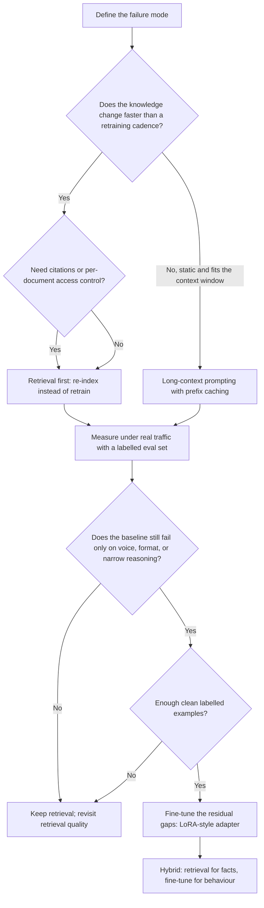

# RAG vs. Fine-Tuning: A Comparative Decision Brief for Enterprise AI Assistants

## Table of contents

- [How to read this brief: what the corpus can and cannot settle](#how-to-read-this-brief-what-the-corpus-can-and-cannot-settle)
- [The reframing the sources agree on: knowledge versus behaviour](#the-reframing-the-sources-agree-on-knowledge-versus-behaviour)
- [Data freshness and knowledge updates](#data-freshness-and-knowledge-updates)
  - [Why the update cadence, not the technique, is the first filter](#why-the-update-cadence-not-the-technique-is-the-first-filter)
- [Evaluation and measurement](#evaluation-and-measurement)
  - [The measurement practices the corpus prescribes](#the-measurement-practices-the-corpus-prescribes)
  - [The only research-grade comparison reaches the reader second-hand](#the-only-research-grade-comparison-reaches-the-reader-second-hand)
- [Latency](#latency)
  - [The retrieval hop: what the numbers claim and what they omit](#the-retrieval-hop-what-the-numbers-claim-and-what-they-omit)
  - [The contested claim that fine-tuning always answers faster](#the-contested-claim-that-fine-tuning-always-answers-faster)
- [Cost](#cost)
  - [Two cost shapes: paying to index versus paying to train](#two-cost-shapes-paying-to-index-versus-paying-to-train)
  - [Where the cost claims conflict and where the crossover is asserted](#where-the-cost-claims-conflict-and-where-the-crossover-is-asserted)
- [Security, access control, and compliance](#security-access-control-and-compliance)
  - [Access control is enforced at retrieval time, not at generation time](#access-control-is-enforced-at-retrieval-time-not-at-generation-time)
  - [Retrieval widens the exposure surface as well as controlling it](#retrieval-widens-the-exposure-surface-as-well-as-controlling-it)
  - [Fine-tuning's security trade is not free](#fine-tunings-security-trade-is-not-free)
- [A staged path the evidence supports](#a-staged-path-the-evidence-supports)
  - [Start with retrieval, then measure, then fine-tune the gaps](#start-with-retrieval-then-measure-then-fine-tune-the-gaps)
  - [Hybrid patterns: what they buy and what they cost in complexity](#hybrid-patterns-what-they-buy-and-what-they-cost-in-complexity)
  - [Data-readiness gates before committing to fine-tuning](#data-readiness-gates-before-committing-to-fine-tuning)
- [Third options that bypass the retrieval-versus-fine-tuning choice](#third-options-that-bypass-the-retrieval-versus-fine-tuning-choice)
  - [Long context plus prefix caching for small, slow-moving corpora](#long-context-plus-prefix-caching-for-small-slow-moving-corpora)
  - [Distillation and small task-specific models for narrow, high-volume work](#distillation-and-small-task-specific-models-for-narrow-high-volume-work)
- [What would change this recommendation, and what the corpus cannot answer](#what-would-change-this-recommendation-and-what-the-corpus-cannot-answer)
- [References](#references)
- [Why this format](#why-this-format)

## How to read this brief: what the corpus can and cannot settle

This brief compares retrieval-augmented generation (RAG), fine-tuning, and hybrid designs across the five dimensions an engineering team named: data freshness, evaluation, latency, cost, and security. The first thing to know is what kind of evidence the underlying pages are. Nearly every source is vendor-authored — company blogs, a service-provider whitepaper, GPU-cloud and retrieval-platform marketing — and their quantitative claims are presented as vendor experience rather than measurement: an agency's client ratio of roughly 70% pure RAG, 20% hybrid, and 10% pure fine-tuning [S-04], a vendor's named-industry scenarios with no client, dates, or metrics [S-11], and a case-study bullet tying a 20% support-volume reduction to the vendor's own platform rather than to RAG or fine-tuning as such [S-30]. Several sources close with calls to book a call, start an assessment, or contact sales, which is context for how their comparisons are framed [S-20][S-30].

Some numbers in the corpus are unsourced and should not be carried into a decision. These include a "30% of customers" outdated-answer anecdote, a "20–30%" tone-and-satisfaction effect [S-15], and a second-hand analyst forecast that 30% of enterprises will adopt generative AI by 2025 [S-06]. None carries a citation, dataset, or method, so none can be verified or bounded; they are marketing motivators, not inputs to an architecture decision.

The guidance also spans a long window. Publication dates run from January 2024 to October 2026, and the newest sources explicitly re-date older advice: one 2026 guide declares that 2023-era retrieval thresholds, RLHF as the default alignment method, and the "stuff versus retrieve" rule are obsolete [S-20]. Any recommendation therefore has to carry its publication date, because older and newer sources disagree partly because they describe different capability baselines.

Two limits bound everything that follows. First, twelve of the thirty ranked URLs were never extracted, so this corpus is a partial sample of available guidance and nothing can be said about the missing pages. Second, no source reports its own controlled measurement of latency, cost, accuracy, or retrieval quality for RAG versus fine-tuning; the only benchmark discussion is a vendor post summarising external papers that are not themselves in the corpus [S-21]. This brief therefore declares no overall winner. It gives per-dimension judgments with stated confidence, and it keeps disagreements intact.

The table below summarises the evidence strength per dimension; each dimension is then treated in its own section.

| Dimension | What the corpus supports | Evidence strength | Material conflict |
|---|---|---|---|
| Data freshness | Retrieval updates by re-indexing; fine-tuning is a snapshot [S-01][S-15][S-17] | Strong — many independent pages converge | None material |
| Evaluation | Prescriptive practice (build an eval set, re-run it) [S-04][S-17][S-20] | Moderate for practice; none for results | No source reports a score |
| Latency | Directional estimates of a retrieval hop [S-17][S-20] | Weak — unattributed practitioner figures | Whether fine-tuning is always faster [S-08] |
| Cost | Directional ranges in incompatible units [S-04][S-11][S-03] | Weak — vendor estimates, no cost model | Retrieval cost at scale [S-06] vs [S-15][S-20] |
| Security | Architectural reasoning on access control and exposure [S-13][S-17][S-26] | Weak-to-moderate; mostly generic LLM-security material | Leakage-risk direction [S-15] vs [S-28] |

## The reframing the sources agree on: knowledge versus behaviour

The sources converge on a reframing rather than a contest. Retrieval governs what an assistant knows and how current that knowledge is; fine-tuning governs how it behaves — style, format, task shape. A comparison table in one 2026 guide puts it plainly: retrieval is best for teaching the model facts (dynamic knowledge), fine-tuning for teaching behaviour (style, format, voice) [S-20]. A decision-framework post states the same rule more bluntly: "Fine-tuning shifts behavior, not knowledge… For facts, use RAG. Full stop." [S-17]. IBM Developer frames the choice as internalising content versus supplying it on demand, keyed to whether data is static or dynamic [S-09]. A quick-comparison table describes retrieval as looking up fresh information and fine-tuning as training the model with examples so it "remembers" skills and tone [S-15].

This framing is why the rest of this brief compares capabilities instead of crowning a technique, and why the staged path later is coherent: if the two techniques do different jobs, the question is not which one wins but which job the assistant is failing at. The framing is asserted by the same vendor-authored sources that sell implementation services, and none of them tests it empirically or against a controlled task set; one source presents it as the answer to "is RAG better than fine-tuning," which is an editorial position rather than an experimental result [S-20].

## Data freshness and knowledge updates

Freshness is the best-supported differentiator in the corpus. Retrieval-based systems absorb new or corrected information by updating a document store or index, whereas a fine-tuned model is a snapshot of its training data whose currency depends on a retraining cadence. One comparison describes RAG as an always-updated assistant that integrates the latest information without frequent retraining, and fine-tuning as a specialist that "requires periodic updates and retraining to keep up with new information" [S-01]. Another states the operational consequence directly: "You don't need to retrain the whole model when data changes; just update the document store" [S-15]. An enterprise whitepaper lists real-time updates as a RAG advantage, "ideal for dynamic fields like legal or news" [S-06]. A vector-database vendor notes that RAG can give models access to new data that changes frequently by updating records in the vector database [S-10]. A decision framework calls a fine-tuned model "a snapshot, and the moment your docs shift, the snapshot is stale," adding that "RAG trades freshness for a retrieval hop" [S-17]. Google Cloud's overview lists fresh, constantly updated data among what the RAG approach supports [S-13]. And a 2026 decision matrix routes dynamic, proprietary, or oversized knowledge to RAG because it "updates in minutes, citable sources, no retraining cost" [S-20].

The magnitude of this advantage is never quantified: no source measures how quickly an update propagates or whether accuracy holds after an update. The 2026 sources also condition the freshness case on corpus size and change rate rather than treating it as unconditional [S-20].

### Why the update cadence, not the technique, is the first filter

The practical question is how often the underlying facts or policies change, and who owns the update path in each architecture. A decision framework makes this its first question: "How fast does your knowledge change? Daily or weekly updates kill fine-tuning… If your data moves faster than your retraining cadence, RAG is the honest answer" [S-17]. A four-question test from a development agency reduces it to a threshold: "Does the required knowledge change more than once a month? RAG" [S-04]. In a retrieval architecture the update path is a re-index; in a fine-tuned architecture it is a retraining run, and the corpus's staged advice is to start with the cheaper-to-iterate option precisely because it exposes which behaviour gaps remain [S-17][S-04].

## Evaluation and measurement

Evaluation practice is the corpus's most concrete operational material, and also the place where the corpus is most clearly prescriptive without results. No source in this corpus reports an eval set, metric definition, or measured score for either approach.

### The measurement practices the corpus prescribes

The recurring prescriptions are consistent. Build a small labelled eval set before changing anything: "Build a 100-query eval set with expected answers on day one. Run it after every change to chunking, embedding, retrieval, or prompt. If accuracy drops below the previous release, revert" [S-04]. The same source lists "testing retrieval quality only with a handful of hand-picked queries" and "skipping evals entirely and shipping on vibes" among common mistakes [S-04]. A decision framework ties project failure to measurement rather than model choice: "Most AI project failures trace back to inadequate measurement, not model choice… A 30-prompt evaluation set, run weekly, catches most regressions before users do" [S-17]. A 2026 guide adds two rules: use task-specific evals rather than training loss and compare against a strong RAG baseline before declaring success, and evaluate context quality independently from model quality [S-20]. On the fine-tuning side, one source says the fine-tuned model should be benchmarked against baseline models to confirm that gains are meaningful and sustainable [S-08].

The prescribed eval-set sizes (100 queries, 30 prompts) are vendor heuristics; no source shares the eval sets, metric definitions, or pass thresholds, and no source reports a before/after score for a real deployment. The guidance can be adopted, but its sufficiency cannot be judged from this corpus.

### The only research-grade comparison reaches the reader second-hand

Only one research-grade comparison is discussed anywhere in the corpus, and it arrives second-hand. A GPU-cloud vendor post summarises a study "published by Microsoft Research in January 2024" that compared RAG, fine-tuning, and fine-tuning used with RAG on the MMLU benchmark [S-21]. The same post reports that a Berkeley paper introduced RAFT (retrieval-augmented fine-tuning) and that "RAFT improves performance for all specialized domains across PubMed, HotPot, HuggingFace, Torch Hub, and Tensorflow Hub" [S-21]. Crucially, the summarising source attaches an explicit scope limit: "While this study shows RAG often outperforms on informational accuracy, this is only one of many use cases. Fine-tuning could perform better than RAG at other tasks like sentiment analysis, NSFW content detection, and tone of voice curation" [S-21].

The underlying papers are not part of the extracted corpus, and no scores, sample sizes, or confidence intervals are reproduced. The summarising source is a GPU-cloud vendor whose post also promotes running these workloads on its platform. The team should therefore not cite the MMLU or RAFT references as proof that retrieval wins on accuracy.

## Latency

Latency evidence is directional and partly contested. There are no controlled latency benchmarks in the corpus, and the quoted figures are unattributed practitioner estimates.

### The retrieval hop: what the numbers claim and what they omit

Retrieval adds a hop. A decision framework quotes it at "typically 100 to 400 milliseconds," adding that for most apps that is invisible but for voice interfaces, real-time gaming, or high-frequency trading copilots it is disqualifying [S-17]. A 2026 guide puts a multiplier on multi-step retrieval: "Agentic RAG is 3-10x slower per query (multiple retrieval and generation rounds)" [S-20]. Both figures are practitioner estimates from vendor or consultancy posts, and neither is decomposed by pipeline configuration — embedding, reranking, cache hit rate, model size — so they cannot be applied directly to a given architecture. The long-context branch is the exception: where a static corpus fits the window, there is no retrieval hop to pay for at all [S-20][S-17].

### The contested claim that fine-tuning always answers faster

Several sources treat internalised knowledge as the faster option. An enterprise whitepaper's comparison table gives fine-tuning "faster inference since responses are generated directly" and RAG "slower due to retrieval before generation" [S-06]. A feature comparison says fine-tuning "is quicker, as it doesn't need to retrieve data and can deliver answers almost instantly" [S-01]. A quick-comparison table lists fine-tuning as "Faster — answers directly" and RAG as "Slower — has to search + answer" [S-15]. A vendor post uses the open-book analogy: retrieval is "minimal prep but longer response times compared to pre-trained knowledge" [S-21].

But the claim is not settled. The same source that says internalised knowledge yields "faster response generation" also warns that "a fine-tuned model may be larger or more complex than a retrieval-based alternative, which can impact inference speed, especially in production environments with latency constraints" [S-08]. That source is internally unresolved, and no controlled benchmark appears in the corpus. Latency should therefore be treated as an empirical question for the team's own stack rather than a slogan.

## Cost

All cost figures in the corpus are vendor estimates in incompatible units — per-hour GPU hosting, per-query token cost, one-time training spend — and no total-cost model exists. They cannot be combined into a total cost of ownership.

### Two cost shapes: paying to index versus paying to train

The two profiles are described consistently in shape. Retrieval is cheap to start and linear to run: "Setup: 1–2 weeks of engineering, <$100 of embedding spend for most corpora. Per-query cost: the retrieval hop (~$0.0001) plus the LLM call ($0.005–$0.02). No GPU, no training, no ops" [S-04]. A GPU-cloud vendor estimates an enterprise-IT RAG build at "low five figures (infrastructure + dev time + API/model fees)" with a "1 to 2 weeks" completion time [S-11]. Fine-tuning inverts the shape: a one-time training investment followed by cheaper inference. Training a LoRA adapter is quoted at "3–6 weeks, $1,000–$20,000 depending on model and data prep," with per-query cost the same as the base model [S-04]. A quick-comparison table summarises the same contrast: RAG setup is "Low (just index your docs)" with runtime cost that "can get expensive at scale," while fine-tuning is "High (needs curated data + training jobs)" but "cheaper per query after training" [S-15]. One source cites a second-hand hosting range of "$0.53 and $7.34 per hour" for a 70B model, which is context for operational cost rather than a measured cost of either technique [S-03].

The scopes differ — embedding spend, per-query token cost, GPU-hour hosting, one-time training spend — and none is audited or reproducible. The data-readiness question that gates the fine-tuning spend is treated separately below.

### Where the cost claims conflict and where the crossover is asserted

Sources disagree about retrieval's cost trajectory. An enterprise whitepaper presents RAG as "cost-efficient: reduces expensive retraining cycles, ensuring scalable enterprise adaptation with minimal overhead" [S-06]. Other sources stress the opposite direction at scale: "at scale, runtime costs can grow because every query does retrieval" [S-15], and a comparison table gives RAG a "higher per-query (retrieval + larger prompts)" profile against fine-tuning's "higher upfront (training, evals); lower per-query" [S-20]. The disagreement is about framing rather than measurement: no source provides a cost model, token accounting, or a worked total-cost comparison, and the whitepaper that calls retrieval cost-efficient also markets the provider's own AI strategy services [S-06].

The economic crossover is asserted rather than derived. One source states that "below ~100k queries/month, the economics favour RAG" [S-04]; another says fine-tuning "can be cheaper per answer once deployed" [S-15]. Neither shows the arithmetic, token counts, or price assumptions behind the crossover, and the threshold is stated in queries per month while the other cost figures are per-query or one-time, so the two cannot be reconciled from this evidence.

## Security, access control, and compliance

Security is where the corpus is thinnest in the sense that matters. Only a minority of the security sources address retrieval or weight-embedded knowledge directly; the rest are general LLM-security guidance — prompt injection, jailbreaks, rate limiting, EU AI Act scope, attack-surface framing — partly predating current architectures [S-25][S-28][S-26]. One digest states regulatory exposure under the EU AI Act as fines of up to 35M Euro without tying it to any architecture choice [S-28].

### Access control is enforced at retrieval time, not at generation time

Retrieval is the layer that can enforce authorisation per document and per caller and that can return inspectable, citable evidence. Google Cloud makes citation a gate: "do you need the model to always give a citation of a source grounded in your data? If yes, you will need to use RAG," adding that "you can control who has access to which grounding data (based on who's calling the model)" [S-13]. A 2026 decision matrix lists "you need strict access control per-document (RAG can filter at retrieval time)" among the conditions where RAG still wins [S-20]. A decision framework contrasts the two: "RAG returns the document it used to answer. Fine-tuning bakes facts into weights you cannot inspect. Regulated industries almost always need the receipt" [S-17]. A comparison table routes regulated or audited domains to RAG or hybrid for "traceability, compliance-friendly" reasons [S-15].

The per-document filtering claim is architectural reasoning from vendor sources; none reports implementing or testing an access-control scheme, and the strongest compliance phrasing — that fine-tuning without RAG "rarely survives a compliance review" — is an unsourced assertion in a development agency's blog [S-17]. No source cites a specific regulatory requirement that mandates citation or forbids weight-embedded knowledge for assistants.

### Retrieval widens the exposure surface as well as controlling it

Retrieval also expands the exposure surface. An FAQ-style security source states that "AI increases the attack surface because it expands where sensitive data is stored, copied, queried, and reused," and that connectors, index copies, cached context, and prompt/response logs each create additional places where sensitive data is stored or reused [S-26]. The same source warns that "if the access model is too coarse, the AI can become a convenient front end to data the requester should never have reached directly," and that "prompt and response logging can preserve sensitive material longer than intended" [S-26]. A RAG-focused source lists security and compliance among RAG's challenges: "a poorly configured knowledge base could expose sensitive content to unauthorized users" [S-08]. A retrieval-platform post opens its argument with the Microsoft Copilot incident, where "weak access controls can lead to data leaks" [S-30].

The corpus's recommended tests are scoping and least privilege rather than technique choice: confirm that access granted to the AI service is narrower than access available to the underlying business user or support role, and treat connector scope and data classification as the first control decision [S-26]. No source quantifies how much extra exposure a retrieval stack adds, and none examines a specific enterprise access-control implementation.

### Fine-tuning's security trade is not free

Fine-tuning relocates security obligations rather than removing them. A comparison table requires that "data used in training must respect consent & bias audits" [S-15]. A security digest summarises a study finding "significant disparities between the original foundation model and fine-tuned variants" in alignment and susceptibility to jailbreak instructions [S-28]. A security vendor hedges its own recommendation of fine-tuning as a control: "Does it always work? Probably not. Does it generally work? Yes, because you are providing guard rails for the LLM from which they shouldn't deviate" [S-25].

The corpus is internally inconsistent on leakage risk. One source asserts that "fine-tuning keeps all data inside the model, so it's less likely to leak private files" [S-15] — a single unsourced claim that points the other way from the alignment findings, and that sits beside the same source's own table row requiring consent and bias audits for training data. The alignment claim itself arrives as a one-paragraph digest summary of someone else's study; neither the study nor any measurement is in the corpus.

## A staged path the evidence supports

The corpus converges on a staged path rather than a single choice: start with retrieval because it is faster and cheaper to iterate and because it exposes which behaviour gaps remain, measure under real traffic, then fine-tune only the residual voice, format, or narrow-reasoning gaps, with hybrid described as the usual production endpoint [S-17][S-04][S-20][S-11][S-09][S-06]. The sequencing is recommended by vendor and agency playbooks; no source reports a deployment that followed it and was measured.

<!-- diagram: staged-decision-path -->

Figure 1. The staged path as the corpus states it: knowledge that changes often, needs citation, or must respect per-document entitlements points to retrieval first, because updates arrive by re-indexing rather than retraining and answers can carry inspectable sources [S-17][S-20][S-13]; a static corpus that fits the context window is the branch where long-context prompting with caching can remove the retrieval hop entirely [S-20][S-17]; after a measurement period, only the failures that retrieval cannot fix — voice, output format, narrow reasoning — justify a LoRA-style fine-tune, and enough labelled examples is the gate on that step [S-17][S-04][S-20]. The diagram omits any ranking of the options because no source in this corpus provides measured comparisons.

### Start with retrieval, then measure, then fine-tune the gaps

The ordering is justified by the sources' reasoning rather than by measured outcomes. A decision framework says to "ship RAG first, because it's faster, cheaper to iterate, and reveals which parts of model behavior actually break under real traffic," and to "fine-tune only what RAG can't reach, which is usually voice, structured outputs, and narrow reasoning patterns" [S-17]. A four-question test from a development agency gives the same order: two yeses from the RAG column means start there [S-04]. A 2026 guide lays out an explicit sequence — prompt engineering, then prompt engineering plus RAG, then a small LoRA adapter for style or format — and says to "only move down the list when the prior step demonstrably fails on your eval set" [S-20]. A GPU-cloud vendor's staged list begins with "start with RAG for immediate deployment and user feedback" [S-11]. IBM Developer describes combining the two so the model understands domain terminology while staying current [S-09], and an enterprise whitepaper calls hybrid "ideal for complex needs requiring retrieval and refined generation" [S-06].

The measurement requirement from the evaluation section is what makes the sequence more than a slogan: the "demonstrably fails on your eval set" condition is the gate between stages [S-20], and the eval set has to exist before the first change [S-04]. The ordering also assumes the reader can afford two rounds of investment, which the corpus does not test against budget-constrained teams.

### Hybrid patterns: what they buy and what they cost in complexity

Hybrid is described consistently at the architecture level: fine-tuning for tone, format, or domain reasoning plus retrieval for facts. A decision framework names the pattern: "The hybrid pattern, sometimes called RAFT (retrieval-augmented fine-tuning), has fine-tuning handle tone and format while retrieval handles facts. Most non-trivial LLM systems end up there" [S-17]. A comparison describes retrieval-augmented fine-tuning as using RAG to retrieve relevant information and then fine-tuning the model on that data for "more accurate and tailored outputs" [S-01]. A quick-comparison table says hybrid setups "combine the strengths of both — Fine-Tuning's consistency and RAG's freshness" [S-15].

The cost is complexity. One source warns of "synchronization of model and knowledge base: as your domain evolves, you must ensure that updates to the fine-tuned model remain aligned with updates to the retrieval database," and notes that desynchronisation produces incoherent answers [S-08]. The complexity warning is qualitative; no source estimates the engineering or evaluation overhead of the coordination layer, and no source in the corpus reports implementing or measuring a hybrid assistant.

### Data-readiness gates before committing to fine-tuning

How much labelled data justifies fine-tuning is not settled. Quoted thresholds diverge: "at least 1,000 clean labeled examples" [S-17], "a few hundred to a few thousand high-quality, high-consistency examples" for LoRA/QLoRA on a frontier-class base model [S-20], and ">10,000 labelled examples of the behaviour you want" [S-04]. None of the thresholds is tied to a measured fine-tuning result or to a stated task difficulty; they are heuristics from vendor playbooks, and the sources also disagree on weighting quality versus quantity. The team must therefore pick its own gate based on the task and count its genuinely labelled examples, using the eval set from the evaluation section to confirm that the fine-tune actually closes the gap it was meant to close [S-04][S-20].

## Third options that bypass the retrieval-versus-fine-tuning choice

The newest sources raise two alternatives that sit outside the binary, and both have limits.

### Long context plus prefix caching for small, slow-moving corpora

A 2026 guide argues that long-context prompting with prefix caching can replace retrieval for corpora that fit the window and change slowly: frontier models now ship with 1M-token context windows, "the 2023 rule 'always use RAG above 100k tokens' no longer holds," and "with prompt caching, long-context is often cheaper than RAG for steady-state workloads on small corpora — a reversal of the 2024 consensus" [S-20]. A decision framework gives a concrete threshold: "If your full knowledge base fits in 200,000 tokens, modern models can hold all of it in prompt with caching. No vector store, no retrieval hop, no pipeline to maintain" [S-17].

The limits are explicit. Both sources are 2026-dated vendor blog posts; the cache-discount percentages and the cost reversal are asserted without measurements, and their corpus-size thresholds differ (200k versus up to 1M tokens) [S-20][S-17]. More importantly, long context does not address citation-per-answer or per-document access control, which those same sources still credit to retrieval [S-20][S-13]. The knowledge/behaviour split survives the shift: long context changes how facts are supplied, not how behaviour is shaped.

### Distillation and small task-specific models for narrow, high-volume work

Distillation appears as a third lever, justified on cost and latency grounds for narrow, high-volume work rather than as a fix for factual grounding. A practitioner column lists "cost savings: reduced computational demands lead to lower infrastructure and energy costs" among the benefits of distilled models in enterprise deployments [S-29]. Google Cloud describes distillation as combining two goals: "creating a smaller model that is faster and quicker to process data, and making that model more specific to your tasks" [S-13]. A 2026 decision matrix routes "a narrow, high-volume task and need low latency/cost" to a distilled small task-specific model, claiming "a 1–7B model fine-tuned on your data often beats a frontier API for that one job" [S-20].

The limits: the practitioner column is a sponsored piece that does not compare distillation with RAG or fine-tuning on any measured task [S-29], and the "often beats a frontier API" claim is a vendor assertion with no benchmark, dataset, or evaluation detail attached [S-20]. Distillation is a cost and latency lever that complements rather than replaces the main decision.

## What would change this recommendation, and what the corpus cannot answer

This section rests entirely on corpus absences, so its questions cannot be answered from this research. The staged path above would move if any of the following pilot results appeared:

- A measured cost model at the team's own volume. Nothing in the corpus pairs token counts, retrieval volume, model prices, and evaluation labour into a comparable total cost of ownership, so the ~100k-queries-per-month crossover remains an assertion [S-04][S-15].
- A latency budget under a real pipeline. The 100–400 ms retrieval hop and the 3–10x agentic multiplier are unattributed practitioner estimates, not measurements for any named stack [S-17][S-20].
- Evidence that retrieval quality cannot be repaired. The corpus prescribes eval sets but shares no eval set, metric definition, groundedness or retrieval-precision score, or before/after result, so the team cannot borrow a threshold for "retrieval has failed" [S-04][S-17][S-20].
- A primary benchmark. The MMLU and RAFT studies are cited second-hand and are absent from the corpus, so their magnitudes, conditions, and limits cannot be checked [S-21].
- A compliance requirement that names an architecture. No source cites a specific regulatory requirement that mandates citation or forbids weight-embedded knowledge for assistants [S-13][S-17][S-28].
- Evidence on hybrid orchestration failure modes. The routing rules and the risk of a fine-tuned model contradicting a fresher retrieval layer are named but never measured [S-08][S-17].
- The cost or latency of enforcing per-document access control inside a retrieval pipeline — exactly the control the corpus recommends [S-13][S-26].

Two structural limits also remain. Twelve of the thirty ranked URLs were never extracted, so the sample cannot be characterised as representative of available guidance. And there is no independent or third-party assessment of any vendor claim in the corpus.

## References

- [S-04] RAG vs Fine-Tuning: Which to Use in 2026 | CodeLamda — https://www.codelamda.com/blog/rag-vs-fine-tuning
- [S-11] Pretraining vs. Fine-Tuning vs. RAG: Choosing the Right AI Approach — https://www.coreweave.com/blog/pretraining-vs-fine-tuning-vs-rag-whats-best-for-your-ai-project
- [S-30] Preventing Data Leaks: Strategies for Secure Enterprise AI — https://www.coveo.com/blog/secure-enterprise-ai-strategies
- [S-20] RAG vs. Fine-Tuning: 2026 Decision Guide & Comparison | metacto — https://www.metacto.com/blogs/rag-vs-fine-tuning-vs-other-llm-techniques-choosing-the-right-approach
- [S-15] RAG vs Fine-Tuning — https://www.agicent.com/blog/rag-vs-fine-tuning
- [S-06] RAG vs Fine Tuning for Enterprise LLM Deployment — https://www.v2solutions.com/whitepapers/rag-vs-fine-tuning-for-enterprise-llms
- [S-21] RAG vs. Fine-Tuning: Which Strategy is Best for Customizing LLMs? — https://www.runpod.io/blog/rag-vs-fine-tuning-llm-customization
- [S-01] RAG vs. fine-tuning: Choosing the right method for your LLM — https://www.superannotate.com/blog/rag-vs-fine-tuning
- [S-17] Fine-Tuning vs RAG: A Decision Framework for 2026 — https://redwerk.com/blog/fine-tuning-vs-rag-decision-framework
- [S-08] Fine-Tuning vs RAG: Key Differences Explained (2026 Guide) — https://orq.ai/blog/finetuning-vs-rag
- [S-03] RAG vs. Fine Tuning: Which One is Right for You? — https://vectorize.io/blog/rag-vs-fine-tuning
- [S-13] RAG vs. Fine-tuning and more | Google Cloud Blog — https://cloud.google.com/blog/products/ai-machine-learning/to-tune-or-not-to-tune-a-guide-to-leveraging-your-data-with-llms
- [S-26] Why does AI increase the attack surface for enterprise data? — https://nhimg.org/faq/why-does-ai-increase-the-attack-surface-for-enterprise-data
- [S-28] LLM Security Top Digest: From security incidents and CISO guides to mitigations and EU AI Act — https://adversa.ai/blog/llm-security-top-digest-from-security-incidents-and-ciso-guides-to-mitigations-and-eu-ai-act
- [S-09] RAG vs. fine-tuning: Which AI strategy should you choose? — https://developer.ibm.com/articles/awb-rag-vs-fine-tuning
- [S-10] Comparing Retrieval-Augmented Generation With Fine-Tuning — https://upstash.com/blog/comparing-rag-with-ft
- [S-25] What Existing Security Threats Do AI And LLMs Amplify? — https://www.mend.io/blog/what-existing-security-threats-do-ai-and-llms-amplify-what-can-we-do-about-them
- [S-29] How to optimize LLMs for enterprise success — https://www.cio.com/article/4118719/how-to-optimize-llms-for-enterprise-success.html

## Why this format

This is a decision brief rather than a tutorial or a ranked verdict because the reader's goal names five criteria and the corpus supplies directional claims for each without a single measurement. The framing that survives every source is that retrieval governs knowledge and freshness while fine-tuning governs behaviour [S-20][S-17][S-09], which makes the five dimensions the natural organising structure instead of a winner's podium. Freshness is the one dimension supported by many independent pages [S-01][S-06][S-10][S-13][S-15][S-17][S-20], so it carries the confidence and does most of the work in a staged path of retrieval first, measurement, then targeted fine-tuning [S-17][S-04][S-20]. Cost, latency, and evaluation are presented with their conflicts intact: retrieval is called both cost-efficient [S-06] and costlier at scale [S-15][S-20]; fine-tuning is called the faster option [S-01][S-06][S-15] while another same-source passage warns a fine-tuned model may be slower to serve [S-08]; and the only benchmark discussion arrives second-hand with an explicit scope limit [S-21]. Security is where the corpus is thinnest in the sense that matters: retrieval clearly owns per-document enforcement and citation [S-13][S-20][S-17], retrieval also widens the exposure surface through connectors and logs [S-26][S-08], fine-tuning shifts obligations to training-data consent and audit [S-15] and is claimed to weaken safety alignment [S-28] — but most security pages are generic LLM-security material about jailbreaks, prompt injection, and regulation rather than tradeoff analysis [S-25][S-28]. Confidence is therefore limited: vendor-authored sources, twelve unextracted URLs, no controlled benchmarks, and at least three unsourced statistics that a reader should discard [S-15][S-06]. The brief ends with the questions whose answers would actually move the decision, so the team can run the pilot that is missing from the literature rather than choosing on rhetoric.
